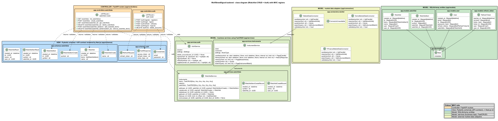
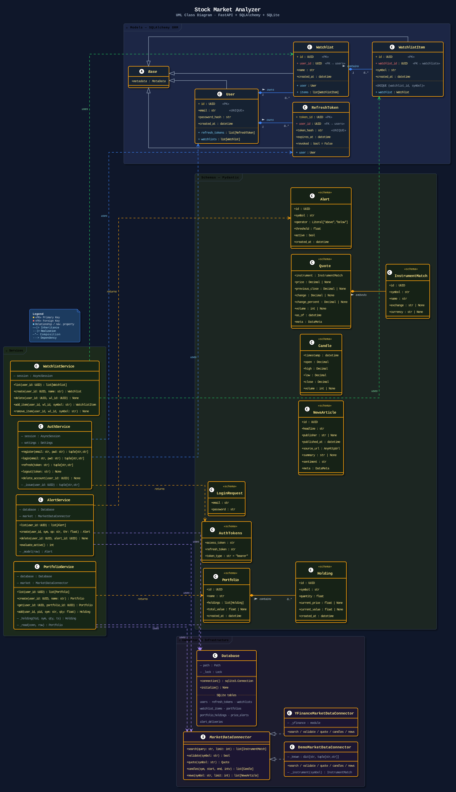
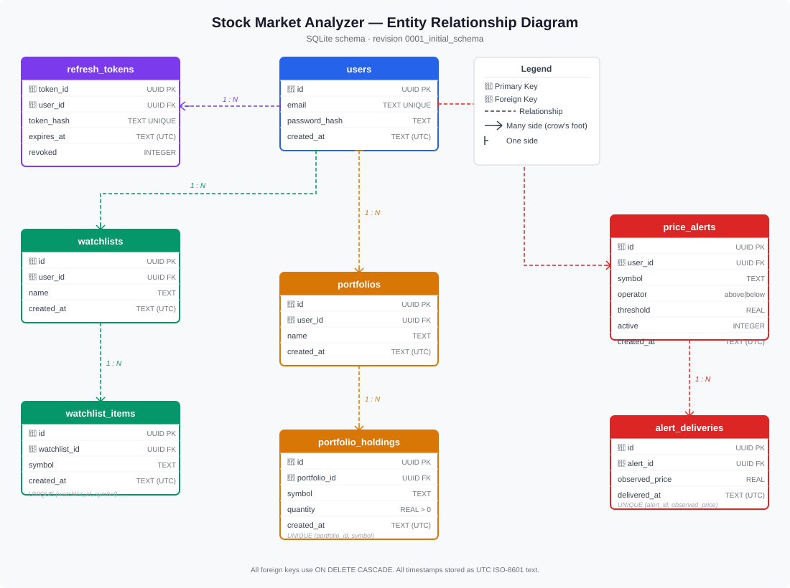

# Stock Market Analyzer — Software Architecture Document

## Table of Contents

- [1. Introduction](#1-introduction)
  - [1.1 Purpose](#11-purpose)
  - [1.2 Scope](#12-scope)
  - [1.3 Definitions, Acronyms and Abbreviations](#13-definitions-acronyms-and-abbreviations)
  - [1.4 References](#14-references)
  - [1.5 Overview](#15-overview)
- [2. Architectural Representation: MVC type](#2-architectural-representation-mvc-type)
  - [2.1 Current state: the Streamlit prototype is not a clean MVC](#21-current-state-the-streamlit-prototype-is-not-a-clean-mvc)
  - [2.2 Target design: Web MVC (Model 2, action-based)](#22-target-design-web-mvc-model-2-action-based-split-between-server-and-client)
  - [2.3 Differences between the prototype and the target design](#23-differences-between-the-prototype-and-the-target-design)
  - [2.4 Frontend MVC (Next.js — planned)](#24-frontend-mvc-nextjs--planned)
- [3. Architectural Goals and Constraints](#3-architectural-goals-and-constraints)
  - [Technology Stack](#technology-stack)
- [4. Use-Case View](#4-use-case-view)
  - [4.1 Use-Case Realizations](#41-use-case-realizations)
- [5. Logical View](#5-logical-view)
  - [5.1 Overview](#51-overview)
  - [5.2 Architecturally Significant Design Packages](#52-architecturally-significant-design-packages)
- [6. Process View](#6-process-view)
- [7. Deployment View](#7-deployment-view)
  - [7.1 Current Deployment](#71-current-deployment)
  - [7.2 Planned Production Deployment](#72-planned-production-deployment)
  - [7.3 Components](#73-components)
  - [7.4 Startup Sequence (Docker Compose)](#74-startup-sequence-docker-compose)
  - [7.5 Configuration (Environment-Driven)](#75-configuration-environment-driven)
- [8. Implementation View](#8-implementation-view)
- [9. Data View](#9-data-view)
  - [9.1 Entity Relationship Diagram](#91-entity-relationship-diagram)
  - [9.2 DB Model Overview](#92-db-model-overview)
- [10. Size and Performance](#10-size-and-performance)
- [11. Quality](#11-quality)

---

## 1. Introduction

### 1.1 Purpose

This document provides a detailed overview of the software architecture of the **Stock Market Analyzer** (product name: *WolfStreet Signal*), an educational market-intelligence platform for retail investors and fintech learners.

It defines the architectural design, framework choices, logical structure, deployment view, and data model. The document serves as a technical reference for developers and maintainers, ensuring alignment with the [Software Requirements Specification](SoftwareRequirementsSpecification.md) (SRS).

### 1.2 Scope

This document describes the architecture of the Stock Market Analyzer in its **current implemented state**: a FastAPI REST backend with a standalone AI module, fully covering all SRS use cases planned for the December delivery (authentication, instruments, watchlists, portfolios, alerts, research brief, and AI chat).

The Next.js + React + TypeScript frontend is **planned** and is documented here as a first-class architectural component to establish the full-stack design before implementation begins. Features from the longer-term vision (news intelligence pipeline, advanced risk engine, volatility forecasting, Redis Streams, TimescaleDB, pgvector) are outside the current scope and not covered in this document.

### 1.3 Definitions, Acronyms and Abbreviations

| Abbreviation | Description |
|---|---|
| API | Application Programming Interface |
| REST | Representational State Transfer |
| WS | WebSocket |
| JWT | JSON Web Token |
| ORM | Object Relational Mapper |
| SPA | Single Page Application |
| CI/CD | Continuous Integration / Continuous Deployment |
| SRS | Software Requirements Specification |
| SAD | Software Architecture Document |
| BDD | Behaviour-Driven Development |
| LLM | Large Language Model |
| CORS | Cross-Origin Resource Sharing |

### 1.4 References

| Title | Date | Publishing organization |
|---|:---:|---|
| [Stock Market Analyzer SRS](SoftwareRequirementsSpecification.md) | 2026-11-22 | WolfStreet Signal Team |
| [WolfStreet Signal Blog](https://wolfstreeetsignalblog.wordpress.com/) | Ongoing | WolfStreet Signal Team |
| [FastAPI Documentation](https://fastapi.tiangolo.com/) | Ongoing | Tiangolo / FastAPI community |
| [SQLAlchemy Documentation](https://docs.sqlalchemy.org/) | Ongoing | SQLAlchemy community |
| [Alembic Documentation](https://alembic.sqlalchemy.org/) | Ongoing | SQLAlchemy community |
| [Pydantic Documentation](https://docs.pydantic.dev/) | Ongoing | Pydantic community |
| [Next.js Documentation](https://nextjs.org/docs) | Ongoing | Vercel |

### 1.5 Overview

This document describes the layered backend architecture (FastAPI REST, service layer, connector abstractions, dual-database persistence) and the planned Next.js frontend. Visual and conceptual breakdowns are provided for each view: logical, process, deployment, implementation, and data.

The key architectural elements are the **Provider Adapter pattern** (all external data sources and LLM providers are swappable via Protocol interfaces), the **dual-database strategy** (SQLAlchemy ORM for identity, raw SQLite for financial domain), and the **layered MVC decomposition** shared by both backend and planned frontend.

---

## 2. Architectural Representation: MVC type

Wolf Street Signal has two code bases today. The project as a whole is moving
from the first to the second:

1. **`ai_module/`**: a Streamlit prototype of the AI features (research brief,
   risk score, volatility forecast, scenarios, AI chat).
2. **`backend/`**: the FastAPI backend we are building as the real product. Its
   first use case, *Manage Watchlist* (CRUD), runs on PostgreSQL. A Next.js
   frontend for it is planned.

### 2.1 Current state: the Streamlit prototype is *not* a clean MVC

We want to be honest here: the prototype was built for speed, not for a clean
separation of concerns.

| File | Intended MVC role | What it really does |
|------|-------------------|---------------------|
| `ai_module/app.py` | View **and** Controller (mixed) | Draws the UI with Streamlit widgets (`st.sidebar`, `st.button`, tabs, charts) **and** handles the user input in the same script: it reads the ticker, checks which feature was chosen, calls `run_pipeline()` and caches results in `st.session_state`. |
| `ai_module/stock_data.py` | Model | Fetches market data from yfinance and computes the numbers: `run_pipeline()`, `validate_ticker()`, `_compute_risk_score()`, `_compute_scenarios()`. |
| `ai_module/ai_engine.py` | Service (outside MVC) | Wraps the Groq LLM API and turns Model data into text: `generate_research_brief()`, `get_risk_explanation()`, `chat_with_ai()`, and so on. |

This happens because Streamlit re-runs the whole script from top to bottom on
every user interaction. There is no separate controller object or routing
step, so view code and control flow end up in the same file. The prototype has
a **separate Model**, but View and Controller are **merged**. That is close to
the "Model 1 / page-centric" style, not a real MVC. Most of the code is plain
functions, so a generated class diagram of `ai_module` would be almost empty.

### 2.2 Target design: Web MVC (Model 2, action-based), split between server and client

The FastAPI backend is our MVC design, and the class diagram in section 5.2 is
generated from it.

| MVC role | Where it lives | Technology | Example (Watchlist CRUD) |
|----------|----------------|------------|--------------------------|
| **Controller** | `backend/app/controllers/` | FastAPI `APIRouter` | `controllers/watchlists.py`: `POST /watchlists`, `GET /watchlists/{id}`, `POST /watchlists/{id}/items`, ... Each endpoint receives the request, gets the current user and the service through dependency injection, and delegates the work. It contains no business logic and no SQL. |
| **Model**: entities | `backend/app/models/` | SQLAlchemy 2.0 ORM on PostgreSQL (Alembic migrations) | `User`, `Watchlist`, `WatchlistItem`, `RefreshToken` |
| **Model**: business logic | `backend/app/services/` | Plain Python classes; `WatchlistService` uses **FastCRUD** | `WatchlistService` enforces ownership, normalises symbols, validates tickers and rejects duplicate symbols; `AuthService` handles registration and login |
| **Model**: external data | `backend/app/connectors/` | Adapter interface (`MarketDataConnector`) with yfinance and demo implementations | Used by `InstrumentService` to check that a ticker exists |
| **View** | `backend/app/schemas/` + Next.js frontend | Pydantic schemas = the JSON contract; Next.js/React render it | `WatchlistCreate`, `WatchlistItemCreate` (input) and `Watchlist`, `WatchlistItem` (output). The Next.js watchlist screens (SCRUM-103) will show this data. |

**Which MVC type, and why:**

- **Action-based (request-based) Web MVC, also called "Model 2".** Every HTTP
  request is sent to exactly one controller action (a router function). The
  action calls the Model and returns data that is turned into the response.
  FastAPI, like Spring MVC or Django, works in this request → action → model →
  response cycle. It is not component-based (like JSF, or Streamlit's widget
  model).
- **The View is split between server and client.** The server does not render
  HTML. Its "view" is the Pydantic response model, which serialises the Model
  to JSON and validates incoming data. The real presentation is rendered on
  the client by Next.js. This is the usual MVC variant for a REST API with a
  separate frontend.
- **The Model has two layers: services and entities.** We do not let
  controllers use the ORM directly. A service layer between them keeps the
  rules (ownership checks, ticker validation, duplicate detection) in one
  testable place, and FastCRUD gives the services the standard CRUD
  operations. FastAPI does not generate CRUD itself, so we use this library.

### 2.3 Differences between the prototype and the target design

| Aspect | Streamlit prototype (`ai_module`) | FastAPI design (`backend`) |
|--------|-----------------------------------|----------------------------|
| View / Controller | Mixed in `app.py` | Separate: routers (Controller) vs. schemas + Next.js (View) |
| Model | Functions in `stock_data.py`, no persistence | SQLAlchemy entities + services, persisted in PostgreSQL |
| AI / LLM | Called directly from the UI script through `ai_engine.py` | Planned behind an adapter (`connectors/llm.py`), called by services; integration is tracked in SCRUM-107 |
| Structure | Mostly functions | Classes, so pyreverse can produce a meaningful class diagram |
| Testability | Hard to test separately from the UI | Services and routers are tested with pytest and behave |

The prototype stays as a quick way to try out AI features. New use cases are
built in the FastAPI MVC structure, and the AI features will move there behind
the service and connector layers.

### 2.4 Frontend MVC (Next.js — planned)

The frontend will be a Next.js + React + TypeScript application consuming the FastAPI backend over REST (and WebSocket for live updates). It follows the same MVC decomposition on the client side:

| MVC Concern | Frontend Role |
|---|---|
| **Model** | Typed API client, TanStack Query server-state stores, Zustand UI-state stores |
| **View** | React components; charts for price history and analysis results |
| **Controller** | Hooks, route handlers, Next.js page loaders |

Business logic never lives in a React component. All computed values (risk scores, forecasts, sentiment) originate from the backend services — the frontend renders them.

---

## 3. Architectural Goals and Constraints

### Technology Stack

The full technology stack is documented in [SRS Section 2.3](SoftwareRequirementsSpecification.md#23-technology-stack). The key framework and infrastructure choices that shape this architecture are summarised below.

| Layer | Technology | Role |
|---|---|---|
| **Backend framework** | Python 3.13 · FastAPI · Uvicorn · Pydantic | REST API, request routing, data validation |
| **ORM / migrations** | SQLAlchemy 2.0 (async) · Alembic | Identity-domain persistence and schema versioning |
| **Frontend (planned)** | Next.js · React · TypeScript | SPA client consuming the REST API |
| **AI prototype** | Python · Streamlit | Standalone AI analysis and chat interface |
| **Databases** | SQLite (dev) · PostgreSQL (prod) | Persistence for identity and financial data |
| **Containerisation** | Docker · Docker Compose | Local development and production deployment |
| **CI** | GitHub Actions | Automated lint, type-check, test, and audit |

### Goals

- Achieve strict separation of concerns across four backend layers so each can evolve, be tested, or be replaced independently.
- Keep external providers (market data, LLM) fully interchangeable via the `Protocol`-based Connector pattern.
- Ensure stateless REST API design with JWT authentication so the backend can scale horizontally.
- Provide transparent, non-advisory financial analysis — all computed values carry explicit uncertainty metadata and disclaimers.
- Deliver a full-stack product: a Next.js frontend consumes the FastAPI backend over REST and WebSocket.
- Support incremental delivery: identity and watchlist features are fully persistent (PostgreSQL via ORM); financial features (portfolios, alerts) are functional on SQLite and can migrate to PostgreSQL without service changes.

### Constraints

- Python 3.13 with FastAPI (backend); Next.js + React + TypeScript (frontend, planned).
- SQLite is the primary local persistence engine; PostgreSQL is the production target.
- No real-money trading, personalized investment recommendations, or financial advice output — enforced at both the LLM connector level and the application layer.
- Target environments: local development with Docker Compose; production deployment with Docker + Nginx.
- Team size is small; frameworks and tooling are chosen to minimize operational overhead.

---

## 4. Use-Case View

This view illustrates the actors and use cases of the Stock Market Analyzer, showing which roles interact with which features. It is derived from and consistent with the [Use-Case Diagram in SRS Section 2.2](SoftwareRequirementsSpecification.md#22-use-case-diagram).


### 4.1 Use-Case Realizations

| Domain | Use Cases | Status |
|---|---|---|
| **Authentication** | Register · Login · Logout · Refresh Token · Delete Account | Implemented |
| **Instruments** | Search for a Stock · View Quote · View Price History | Implemented |
| **Watchlists** | Add Stock · Remove Stock · List Stocks | Implemented |
| **Portfolios** | Create Portfolio · Add Holding · View Portfolio | Implemented |
| **Alerts** | Create Alert · Delete Alert · List Alerts · Evaluate Alerts | Implemented |
| **Research** | Research Brief · Chat with AI | Implemented |
| **Analysis** | Risk Score · Volatility Forecast | Implemented |

---

## 5. Logical View

### 5.1 Overview

The backend is organized as a single-module FastAPI application with a clear directory-per-layer structure. Each layer interacts only with the layer directly below it; cross-layer jumps do not exist in production code.

#### FastAPI Framework Architecture

The diagram below, taken from the [official FastAPI documentation](https://fastapi.tiangolo.com/tutorial/bigger-applications/), shows the modular package structure FastAPI recommends for larger applications — the same layer-separation pattern our backend follows.


*Source: [fastapi.tiangolo.com — Bigger Applications](https://fastapi.tiangolo.com/tutorial/bigger-applications/)*

#### Our Backend Directory Structure

```
backend/app/
├── controllers/    # HTTP layer — FastAPI routers
├── services/       # Business logic layer
├── connectors/     # Provider abstraction layer (Protocol interfaces + implementations)
├── models/         # SQLAlchemy ORM models (identity domain)
├── schemas/        # Pydantic request/response contracts
├── core/           # Cross-cutting: config, security, DB sessions, error handling, rate limiting
├── dependencies.py # FastAPI dependency injection wiring
└── main.py         # App factory, middleware, router registration
```

### 5.2 Architecturally Significant Design Packages

#### Class diagram (generated from code, with MVC regions)



*Figure 5.2: class diagram of the FastAPI backend for the Watchlist CRUD and
Authentication use cases. It was generated from the source code with
pyreverse (pylint 4.1.4) and rendered with PlantUML; nothing was drawn by
hand. Source: [`architecture/class-diagram-mvc.puml`](architecture/class-diagram-mvc.puml).
Regeneration steps: [`architecture/README.md`](architecture/README.md).*

**MVC regions (colours in the diagram):**

- **Controller (orange)**: `watchlists router` and `auth router` in
  `app/controllers`. They map HTTP endpoints to handlers, for example
  `POST /watchlists/{watchlist_id}/items → add_watchlist_item()`, and delegate
  to the services.
- **View (blue)**: the Pydantic schemas in `app/schemas` (`WatchlistCreate`,
  `Watchlist`, `WatchlistItem`, `Credentials`, `AuthResponse`, ...). They form
  the validated JSON contract that the Next.js frontend renders.
- **Model (greens)**:
  - the SQLAlchemy entities in `app/models` (`User`, `Watchlist`,
    `WatchlistItem` and `RefreshToken`, all inheriting from `Base`);
  - the services in `app/services`: `WatchlistService` (built on FastCRUD),
    `AuthService` and `InstrumentService`;
  - the market-data adapters in `app/connectors` (`MarketDataConnector` with
    `YFinanceMarketDataConnector` and `DemoMarketDataConnector`).

**How to read it:** dashed arrows go from a router to the schemas and services
it uses. `WatchlistService` aggregates `InstrumentService`, which aggregates a
`MarketDataConnector`; this is how a ticker is checked before it is added to a
watchlist. The links between entities are shown as typed attributes (for
example `User.watchlists : Mapped[list['Watchlist']]`). The table relations
themselves are in the EER model in section 9.

#### Package dependency diagram (generated, MVC roles)

The module-level dependency diagram of the same code, also generated by
pyreverse and coloured by MVC role (orange = Controller, blue = View/Schema,
green = Model).


*Figure 5.3: package diagram generated with pyreverse.*

#### Full backend overview (hand-drawn)

As an extra overview, the diagram below shows the whole backend across all
four layers: Models (SQLAlchemy ORM), Schemas (Pydantic), Services, and
Connectors. Unlike figures 5.2 and 5.3 it was drawn by hand
([`Media/UML-class-diagram.drawio`](Media/UML-class-diagram.drawio)).



*Figure 5.4: UML class diagram of the WolfStreet Signal backend. ORM models (top), Pydantic schemas (centre), services (left), connectors and database (bottom). Arrows show ownership, composition, and dependency relationships between classes.*

---

#### `core/` — Cross-cutting Infrastructure

Owns configuration, security primitives, persistence bootstrapping, error catalog, and rate limiting. Contains no domain logic.

| Component | Role |
|---|---|
| `config.py` | `Settings` (Pydantic `BaseSettings`); reads environment variables or `.env`. Single-instance via `@lru_cache`. |
| `security.py` | Argon2 password hashing, JWT creation/validation (`HS256`), refresh token generation (UUID hex). |
| `database.py` | SQLAlchemy async engine + `AsyncSession` factory; used by identity services via DI. |
| `db.py` | `Database` class — raw `sqlite3` connection factory with thread safety (`threading.Lock`). Creates and owns all 8 SQLite tables via `initialize()`. |
| `errors.py` | `BackendError` (single typed exception class with `code`, `message`, `status_code`, `details`); FastAPI exception handlers. |
| `rate_limit.py` | `FixedWindowLimiter` — in-memory, per-IP rate limiting. Global API limiter (120 req/min), stricter auth limiter (30 req/min). |

---

#### `models/` — SQLAlchemy ORM (Identity Domain)

SQLAlchemy `DeclarativeBase` models covering the four identity-domain tables managed by Alembic migrations.

| Model | Key Fields | Relationships |
|---|---|---|
| `User` | `id UUID PK`, `email UNIQUE`, `password_hash`, `created_at` | 1→N `RefreshToken`, 1→N `Watchlist` |
| `RefreshToken` | `token_id UUID PK`, `user_id FK`, `token_hash UNIQUE`, `expires_at`, `revoked` | N→1 `User` (CASCADE DELETE) |
| `Watchlist` | `id UUID PK`, `user_id FK`, `name`, `created_at` | N→1 `User` (CASCADE), 1→N `WatchlistItem` |
| `WatchlistItem` | `id UUID PK`, `watchlist_id FK`, `symbol`, `created_at`, UNIQUE(`watchlist_id`, `symbol`) | N→1 `Watchlist` (CASCADE) |

---

#### `connectors/` — Provider Abstraction Layer

The Connector pattern is the most significant architectural element in the codebase. All external dependencies are accessed through Python `Protocol` interfaces, ensuring no service code is coupled to a specific provider.

**`MarketDataConnector` (Protocol)**

Defines five async methods: `search`, `validate`, `quote`, `candles`, `news`. Two implementations are provided:

| Implementation | Description |
|---|---|
| `DemoMarketDataConnector` | Deterministic local connector. Returns hard-coded data for 5 tickers (AAPL, MSFT, TSLA, AMZN, GOOGL). Active when `MARKET_DATA_PROVIDER=demo`. |
| `YFinanceMarketDataConnector` | Wraps the `yfinance` library. Provides live Yahoo Finance data. Active when `MARKET_DATA_PROVIDER=yfinance`. |

**`LLMConnector` (Protocol)**

Defines `brief(ticker, context)` and `chat(ticker, context, messages)`. Two implementations:

| Implementation | Description |
|---|---|
| `DisabledLLMConnector` | Safe local no-op; returns canned text. Active when `LLM_PROVIDER=disabled`. |
| `GroqLLMConnector` | Wraps the Groq SDK. Never generates buy/sell/hold advice — validated in `_complete()`. Active when `LLM_PROVIDER=groq`. |

---

#### `services/` — Business Logic Layer

Each service class owns a single functional domain. Services accept injected dependencies (session, database, connectors) and return Pydantic schemas. No service imports another service.

| Service | Dependencies | Responsibility |
|---|---|---|
| `AuthService` | `AsyncSession`, `Settings` | User registration/login, JWT + refresh token lifecycle, account deletion. |
| `WatchlistService` | `AsyncSession` | Watchlist CRUD; enforces per-user ownership; validates via ORM. |
| `PortfolioService` | `Database`, `MarketDataConnector` | Portfolio and holding CRUD with live price enrichment. Uses raw SQLite. |
| `AlertService` | `Database`, `MarketDataConnector` | Price alert creation/deletion; idempotent evaluation via UNIQUE constraint on `(alert_id, observed_price)`. |
| `InstrumentService` | `MarketDataConnector` | Search, quote, and history with provider caching and stale-data fallback. |
| `AnalysisService` | `MarketDataConnector` | Annualized volatility (`risk-v1`), geometric Brownian motion scenario forecast (`forecast-v1`). All results carry `AnalysisMeta` with disclaimer and assumptions. |
| `ResearchService` | `MarketDataConnector`, `LLMConnector` | Assembles market context and delegates to the LLM. Never surfaces personalized advice. |

---

#### `controllers/` — HTTP Layer

FastAPI `APIRouter` modules. Each controller has a one-to-one correspondence with a service. Controllers are thin: they validate parameters via Pydantic, call one service method, and return the result.

| Router | Prefix | Endpoints |
|---|---|---|
| `health` | `/api/v1/health` | `GET /live`, `GET /ready` |
| `auth` | `/api/v1/auth` | `POST /register`, `POST /login`, `POST /refresh`, `POST /logout`, `DELETE /me` |
| `instruments` | `/api/v1/instruments` | `GET /search`, `GET /{symbol}/quote`, `GET /{symbol}/history` |
| `watchlists` | `/api/v1/watchlists` | CRUD for watchlists and watchlist items |
| `portfolio` | `/api/v1/portfolios` | CRUD for portfolios and holdings |
| `alerts` | `/api/v1/alerts` | CRUD for price alerts |
| `analysis` | `/api/v1/analysis` | `GET /{symbol}/risk`, `GET /{symbol}/forecast` |
| `research` | `/api/v1/research` | `GET /{symbol}/brief`, `POST /{symbol}/chat` |

---

#### `schemas/` — Pydantic Contracts

Pydantic `BaseModel` schemas act as the data contract layer between all tiers. They enforce types at the boundary, eliminating defensive casting inside services.

Key schema groups:

- **`v1.py`** — Core shared types: `Quote`, `Candle`, `InstrumentMatch`, `NewsArticle`, `DataMeta`, `Availability`, `Page[T]`, `HistoryResponse`.
- **`auth.py`** — `Credentials`, `AuthResponse`, `RefreshRequest`.
- **`portfolio.py`** — `Portfolio`, `Holding`.
- **`alerts.py`** — `Alert`.
- **`analysis.py`** — `RiskProfile`, `ForecastResponse`, `AnalysisMeta`.
- **`research.py`** — `BriefResponse`, `ChatMessage`, `ChatResponse`.

---

#### `ai_module/` — Standalone AI Prototype

A self-contained Python module (`ai_engine.py`, `stock_data.py`, `app.py`) developed independently from the main backend. It provides early AI analysis capabilities and has its own `requirements.txt` and test suite. Integration with the main backend is pending.

---

## 6. Process View

*Not applicable for this project scope.*

---

## 7. Deployment View

The Stock Market Analyzer uses a containerized single-host architecture managed with Docker Compose.

### 7.1 Current Deployment

```
Client Browser
      │  HTTP/HTTPS
      ▼
  Backend Container (port 8000)
  FastAPI + Uvicorn
      │
      └── SQLite database file (backend/data/app.db)
              · 4 ORM-managed tables (users, tokens, watchlists, watchlist_items)
              · 4 raw SQLite tables (portfolios, holdings, alerts, deliveries)
```

The current setup requires no additional infrastructure: the backend runs as a single container and uses a local SQLite file. No Redis, no PostgreSQL, no worker containers.

### 7.2 Planned Production Deployment

```
Client Browser
      │  HTTPS
      ▼
  Nginx (reverse proxy, port 443)
      │
      ├── / → Next.js Frontend container (port 3000)
      └── /api → Backend Container (port 8000)
                      │
                      └── PostgreSQL (port 5432)
```

PostgreSQL replaces SQLite for all 8 tables. The SQLAlchemy ORM tables are migrated via Alembic; the raw SQLite tables are migrated through a planned migration step. Nginx handles TLS termination and path-based routing.

### 7.3 Components

| Component | Technology | Status |
|---|---|---|
| Backend | Python 3.13 · FastAPI · Uvicorn | Implemented |
| AI module | Python · Streamlit (standalone) | Implemented |
| Frontend | Next.js · React · TypeScript | Planned |
| Database (dev) | SQLite (aiosqlite) | Implemented |
| Database (prod) | PostgreSQL 17+ | Planned |
| Reverse proxy | Nginx | Planned |
| Container runtime | Docker + Docker Compose | Implemented |
| CI environment | GitHub Actions + PostgreSQL service | Implemented |

### 7.4 Startup Sequence (Docker Compose)

```
docker compose up --build
    │
    ▼
PostgreSQL starts   ← health check before API starts
    │
    ▼
Alembic upgrade head   ← applies pending migrations
    │
    ▼
uvicorn app.main:app   ← starts FastAPI on 0.0.0.0:8000
    │
    ▼
Database.initialize()  ← idempotently creates SQLite tables (financial domain)
```

### 7.5 Configuration (Environment-Driven)

| Variable | Default | Purpose |
|---|---|---|
| `MARKET_DATA_PROVIDER` | `demo` | Selects connector implementation (`demo` or `yfinance`) |
| `LLM_PROVIDER` | `disabled` | Selects LLM connector (`disabled` or `groq`) |
| `DATABASE_URL` | SQLite path | SQLAlchemy async engine target |
| `DATABASE_PATH` | `backend/data/app.db` | Raw SQLite path for `Database` class |
| `JWT_SECRET` | *(dev placeholder)* | HS256 signing key — must be overridden in production |
| `GROQ_API_KEY` | `None` | Required only when `LLM_PROVIDER=groq` |

---

## 8. Implementation View

*Not applicable for this project scope.*

---

## 9. Data View

The backend uses two persistence engines:

- **SQLAlchemy ORM** manages the identity domain (users, tokens, watchlists) where schema migrations, type safety, and relational integrity are critical.
- **Raw SQLite** via the `Database` class manages the financial domain (portfolios, holdings, alerts, deliveries) where the simpler API is sufficient. Migration to PostgreSQL is a planned next step.

All foreign keys use `ON DELETE CASCADE`. All timestamps are stored in UTC.

### 9.1 Entity Relationship Diagram

The ERD covers all 8 tables. Tables in the same color group are owned by the same persistence engine and functional domain.

| Domain | Tables | Engine |
|---|---|---|
| Identity | `users`, `refresh_tokens` | SQLAlchemy ORM |
| Watchlists | `watchlists`, `watchlist_items` | SQLAlchemy ORM |
| Portfolios | `portfolios`, `portfolio_holdings` | Raw SQLite (`Database`) |
| Alerts | `price_alerts`, `alert_deliveries` | Raw SQLite (`Database`) |

### 9.2 DB Model Overview

The EER diagram showing all current tables, columns, data types, keys, and foreign-key relationships:



**Key design decisions:**

- `users.id`, `watchlists.id`, `portfolios.id` are UUIDs, generated in application code — no database-side `AUTOINCREMENT`.
- `refresh_tokens.token_hash` stores a SHA-256 hash of the token; raw token values are never persisted.
- `watchlist_items` enforces `UNIQUE(watchlist_id, symbol)` — a symbol can appear only once per watchlist.
- `portfolio_holdings` enforces `UNIQUE(portfolio_id, symbol)` — position additions are updates, not inserts.
- `alert_deliveries` enforces `UNIQUE(alert_id, observed_price)` — idempotency guard so the alert evaluation worker can be re-run without duplicate notifications.

---

## 10. Size and Performance

*Not applicable for this project scope.*

---

## 11. Quality

*Not applicable for this project scope.*
