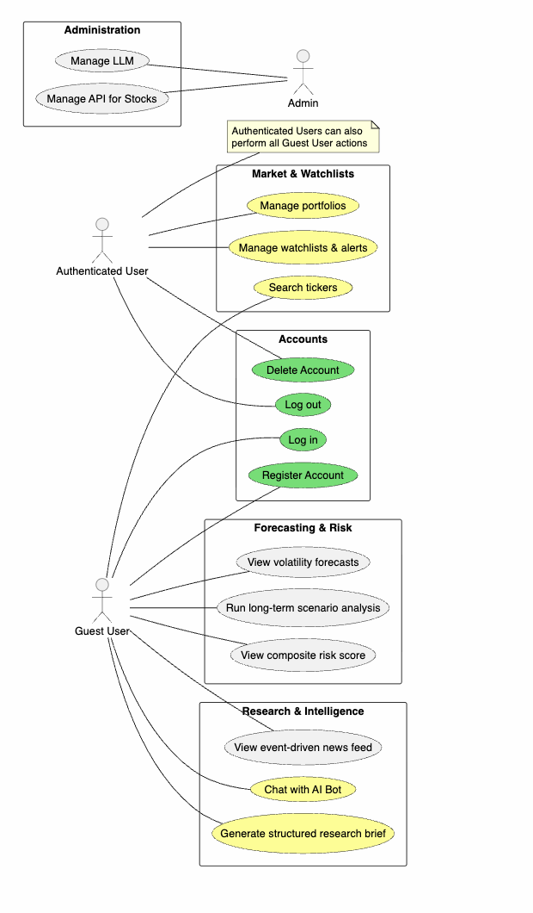
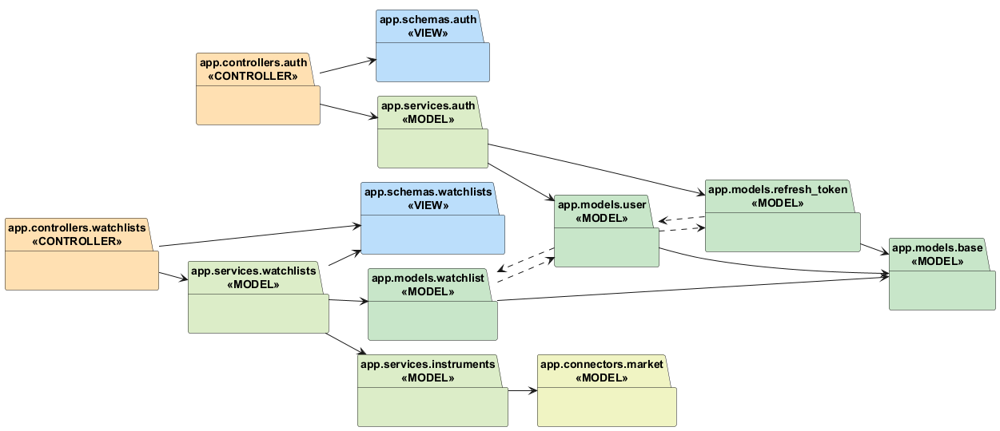

# Stock Market Analyzer — Software Architecture Document

## Table of Contents

- [1. Introduction](#1-introduction)
  - [1.1 Purpose](#11-purpose)
  - [1.2 Scope](#12-scope)
  - [1.3 Definitions, Acronyms and Abbreviations](#13-definitions-acronyms-and-abbreviations)
  - [1.4 References](#14-references)
  - [1.5 Overview](#15-overview)
- [2. Architectural Representation](#2-architectural-representation)
  - [2.1 Backend Architecture (FastAPI — Layered MVC)](#21-backend-architecture-fastapi--layered-mvc)
  - [2.2 Frontend Architecture (Next.js — Planned)](#22-frontend-architecture-nextjs--planned)
  - [2.3 MVC Mapping](#23-mvc-mapping)
- [3. Architectural Goals and Constraints](#3-architectural-goals-and-constraints)
- [4. Use-Case View](#4-use-case-view)
  - [4.1 Use-Case Realizations](#41-use-case-realizations)
- [5. Logical View](#5-logical-view)
  - [5.1 Overview](#51-overview)
  - [5.2 Architecturally Significant Design Packages](#52-architecturally-significant-design-packages)
- [6. Process View](#6-process-view)
- [7. Deployment View](#7-deployment-view)
  - [7.1 Current Deployment](#71-current-deployment)
  - [7.2 Planned Production Deployment](#72-planned-production-deployment)
  - [7.3 Components](#73-components)
  - [7.4 Startup Sequence (Docker Compose)](#74-startup-sequence-docker-compose)
  - [7.5 Configuration (Environment-Driven)](#75-configuration-environment-driven)
- [8. Implementation View](#8-implementation-view)
  - [8.1 Overview](#81-overview)
  - [8.2 Layers](#82-layers)
- [9. Data View](#9-data-view)
  - [9.1 Entity Relationship Diagram](#91-entity-relationship-diagram)
  - [9.2 DB Model Overview](#92-db-model-overview)
- [10. Size and Performance](#10-size-and-performance)
  - [10.1 Size](#101-size)
  - [10.2 Performance](#102-performance)
- [11. Quality](#11-quality)
  - [11.1 CI Pipeline Results](#111-ci-pipeline-results)
  - [11.2 Planned Improvements](#112-planned-improvements)

---

## 1. Introduction

### 1.1 Purpose

This document provides a detailed overview of the software architecture of the **Stock Market Analyzer** (product name: *WolfStreet Signal*), an educational market-intelligence platform for retail investors and fintech learners.

It defines the architectural design, framework choices, logical structure, deployment view, and data model. The document serves as a technical reference for developers and maintainers, ensuring alignment with the [Software Requirements Specification](SoftwareRequirementsSpecification.md) (SRS).

### 1.2 Scope

This document describes the architecture of the Stock Market Analyzer in its **current implemented state**: a FastAPI REST backend with a standalone AI module, fully covering all SRS use cases planned for the December delivery (authentication, instruments, watchlists, portfolios, alerts, research brief, and AI chat).

The Next.js + React + TypeScript frontend is **planned** and is documented here as a first-class architectural component to establish the full-stack design before implementation begins. Features from the longer-term vision (news intelligence pipeline, advanced risk engine, volatility forecasting, Redis Streams, TimescaleDB, pgvector) are outside the current scope and not covered in this document.

### 1.3 Definitions, Acronyms and Abbreviations

| Abbreviation | Description |
|---|---|
| API | Application Programming Interface |
| REST | Representational State Transfer |
| WS | WebSocket |
| JWT | JSON Web Token |
| ORM | Object Relational Mapper |
| SPA | Single Page Application |
| CI/CD | Continuous Integration / Continuous Deployment |
| SRS | Software Requirements Specification |
| SAD | Software Architecture Document |
| BDD | Behaviour-Driven Development |
| LLM | Large Language Model |
| CORS | Cross-Origin Resource Sharing |

### 1.4 References

| Title | Date | Publishing organization |
|---|:---:|---|
| [Stock Market Analyzer SRS](SoftwareRequirementsSpecification.md) | 2026-11-22 | WolfStreet Signal Team |
| [WolfStreet Signal Blog](https://wolfstreeetsignalblog.wordpress.com/) | Ongoing | WolfStreet Signal Team |
| [FastAPI Documentation](https://fastapi.tiangolo.com/) | Ongoing | Tiangolo / FastAPI community |
| [SQLAlchemy Documentation](https://docs.sqlalchemy.org/) | Ongoing | SQLAlchemy community |
| [Alembic Documentation](https://alembic.sqlalchemy.org/) | Ongoing | SQLAlchemy community |
| [Pydantic Documentation](https://docs.pydantic.dev/) | Ongoing | Pydantic community |
| [Next.js Documentation](https://nextjs.org/docs) | Ongoing | Vercel |

### 1.5 Overview

This document describes the layered backend architecture (FastAPI REST, service layer, connector abstractions, dual-database persistence) and the planned Next.js frontend. Visual and conceptual breakdowns are provided for each view: logical, process, deployment, implementation, and data.

The key architectural elements are the **Provider Adapter pattern** (all external data sources and LLM providers are swappable via Protocol interfaces), the **dual-database strategy** (SQLAlchemy ORM for identity, raw SQLite for financial domain), and the **layered MVC decomposition** shared by both backend and planned frontend.

---

## 2. Architectural Representation

The Stock Market Analyzer is built on a **MVC + service-layer architecture** with a clear technology split: **Python (FastAPI)** for the backend, **Next.js + TypeScript** for the planned frontend.

### 2.1 Backend Architecture (FastAPI — Layered MVC)

The FastAPI backend follows a **layered architecture** with four clearly separated tiers: **Controllers → Services → Connectors → Persistence**. This is a REST-focused adaptation of MVC where:

- **Controllers** (FastAPI routers) handle request routing, parameter validation via Pydantic, and response serialization.
- **Services** hold all application logic, orchestrate connectors, and interact with the persistence tier.
- **Connectors** isolate external dependencies (market data providers, LLM providers) behind Protocol interfaces.
- **Persistence** is split across two engines: SQLAlchemy async ORM (identity domain) and raw SQLite via `Database` (financial domain).

All layers communicate through Pydantic schemas, which serve as the single source of truth for data contracts.

```
HTTP Request
    │
    ▼
 Controller (FastAPI Router)
  · validates via Pydantic schema
  · delegates to service via DI
    │
    ▼
 Service (Business Logic)
  · orchestrates connectors and persistence
  · returns Pydantic schema
    │
    ├──────────────────────────┐
    ▼                          ▼
 Connector                 Persistence
 (Protocol interface)      · SQLAlchemy ORM (identity domain)
 · MarketDataConnector      · Database / raw SQLite (financial domain)
 · LLMConnector
    │
    ▼
 External Provider
 (yfinance / Groq / Demo)
```

### 2.2 Frontend Architecture (Next.js — Planned)

The frontend will be a Next.js + React + TypeScript application consuming the FastAPI backend over REST (and WebSocket for live updates). It follows the same MVC decomposition on the client side:

| MVC Concern | Frontend Role |
|---|---|
| **Model** | Typed API client, TanStack Query server-state stores, Zustand UI-state stores |
| **View** | React components; charts for price history and analysis results |
| **Controller** | Hooks, route handlers, Next.js page loaders |

Business logic never lives in a React component. All computed values (risk scores, forecasts, sentiment) originate from the backend services — the frontend renders them.

### 2.3 MVC Mapping

| Concern | Backend (Implemented) | Frontend (Planned) |
|---|---|---|
| **Model** | ORM entities, domain objects | Typed API client, state stores |
| **View** | Pydantic response schemas | React components, chart renderers |
| **Controller** | FastAPI routers | Hooks, route handlers, page loaders |
| **Service layer** | Auth, Watchlist, Portfolio, Alert, Instrument, Analysis, Research | Thin; formatting only |

---

## 3. Architectural Goals and Constraints

### Goals

- Achieve strict separation of concerns across four backend layers so each can evolve, be tested, or be replaced independently.
- Keep external providers (market data, LLM) fully interchangeable via the `Protocol`-based Connector pattern.
- Ensure stateless REST API design with JWT authentication so the backend can scale horizontally.
- Provide transparent, non-advisory financial analysis — all computed values carry explicit uncertainty metadata and disclaimers.
- Deliver a full-stack product: a Next.js frontend consumes the FastAPI backend over REST and WebSocket.
- Support incremental delivery: identity and watchlist features are fully persistent (PostgreSQL via ORM); financial features (portfolios, alerts) are functional on SQLite and can migrate to PostgreSQL without service changes.

### Constraints

- Python 3.13 with FastAPI (backend); Next.js + React + TypeScript (frontend, planned).
- SQLite is the primary local persistence engine; PostgreSQL is the production target.
- No real-money trading, personalized investment recommendations, or financial advice output — enforced at both the LLM connector level and the application layer.
- Target environments: local development with Docker Compose; production deployment with Docker + Nginx.
- Team size is small; frameworks and tooling are chosen to minimize operational overhead.

---

## 4. Use-Case View

This view illustrates the actors and use cases of the Stock Market Analyzer, showing which roles interact with which features.



### 4.1 Use-Case Realizations

| Domain | Use Cases | Status |
|---|---|---|
| **Authentication** | Register · Login · Logout · Refresh Token · Delete Account | Implemented |
| **Instruments** | Search for a Stock · View Quote · View Price History | Implemented |
| **Watchlists** | Add Stock · Remove Stock · List Stocks | Implemented |
| **Portfolios** | Create Portfolio · Add Holding · View Portfolio | Implemented |
| **Alerts** | Create Alert · Delete Alert · List Alerts · Evaluate Alerts | Implemented |
| **Research** | Research Brief · Chat with AI | Implemented |
| **Analysis** | Risk Score · Volatility Forecast | Implemented |

---

## 5. Logical View

### 5.1 Overview

The backend is organized as a single-module FastAPI application with a clear directory-per-layer structure. Each layer interacts only with the layer directly below it; cross-layer jumps do not exist in production code.

```
backend/app/
├── controllers/    # HTTP layer — FastAPI routers
├── services/       # Business logic layer
├── connectors/     # Provider abstraction layer (Protocol interfaces + implementations)
├── models/         # SQLAlchemy ORM models (identity domain)
├── schemas/        # Pydantic request/response contracts
├── core/           # Cross-cutting: config, security, DB sessions, error handling, rate limiting
├── dependencies.py # FastAPI dependency injection wiring
└── main.py         # App factory, middleware, router registration
```

### 5.2 Architecturally Significant Design Packages

The diagram below shows the full backend class structure, covering all four layers: Services, Models (SQLAlchemy ORM), Schemas (Pydantic), and Connectors.


*Figure 5.2: UML class diagram of the WolfStreet Signal backend. Services (top), ORM models and Pydantic schemas (centre), connectors and database (right). Arrows show ownership, composition, and dependency relationships between classes.*

**Package dependency diagram — MVC roles**

The auto-generated module-level dependency diagram, coloured by MVC role (orange = Controller, blue = View/Schema, green = Model).



---

#### `core/` — Cross-cutting Infrastructure

Owns configuration, security primitives, persistence bootstrapping, error catalog, and rate limiting. Contains no domain logic.

| Component | Role |
|---|---|
| `config.py` | `Settings` (Pydantic `BaseSettings`); reads environment variables or `.env`. Single-instance via `@lru_cache`. |
| `security.py` | Argon2 password hashing, JWT creation/validation (`HS256`), refresh token generation (UUID hex). |
| `database.py` | SQLAlchemy async engine + `AsyncSession` factory; used by identity services via DI. |
| `db.py` | `Database` class — raw `sqlite3` connection factory with thread safety (`threading.Lock`). Creates and owns all 8 SQLite tables via `initialize()`. |
| `errors.py` | `BackendError` (single typed exception class with `code`, `message`, `status_code`, `details`); FastAPI exception handlers. |
| `rate_limit.py` | `FixedWindowLimiter` — in-memory, per-IP rate limiting. Global API limiter (120 req/min), stricter auth limiter (30 req/min). |

---

#### `models/` — SQLAlchemy ORM (Identity Domain)

SQLAlchemy `DeclarativeBase` models covering the four identity-domain tables managed by Alembic migrations.

| Model | Key Fields | Relationships |
|---|---|---|
| `User` | `id UUID PK`, `email UNIQUE`, `password_hash`, `created_at` | 1→N `RefreshToken`, 1→N `Watchlist` |
| `RefreshToken` | `token_id UUID PK`, `user_id FK`, `token_hash UNIQUE`, `expires_at`, `revoked` | N→1 `User` (CASCADE DELETE) |
| `Watchlist` | `id UUID PK`, `user_id FK`, `name`, `created_at` | N→1 `User` (CASCADE), 1→N `WatchlistItem` |
| `WatchlistItem` | `id UUID PK`, `watchlist_id FK`, `symbol`, `created_at`, UNIQUE(`watchlist_id`, `symbol`) | N→1 `Watchlist` (CASCADE) |

---

#### `connectors/` — Provider Abstraction Layer

The Connector pattern is the most significant architectural element in the codebase. All external dependencies are accessed through Python `Protocol` interfaces, ensuring no service code is coupled to a specific provider.

**`MarketDataConnector` (Protocol)**

Defines five async methods: `search`, `validate`, `quote`, `candles`, `news`. Two implementations are provided:

| Implementation | Description |
|---|---|
| `DemoMarketDataConnector` | Deterministic local connector. Returns hard-coded data for 5 tickers (AAPL, MSFT, TSLA, AMZN, GOOGL). Active when `MARKET_DATA_PROVIDER=demo`. |
| `YFinanceMarketDataConnector` | Wraps the `yfinance` library. Provides live Yahoo Finance data. Active when `MARKET_DATA_PROVIDER=yfinance`. |

**`LLMConnector` (Protocol)**

Defines `brief(ticker, context)` and `chat(ticker, context, messages)`. Two implementations:

| Implementation | Description |
|---|---|
| `DisabledLLMConnector` | Safe local no-op; returns canned text. Active when `LLM_PROVIDER=disabled`. |
| `GroqLLMConnector` | Wraps the Groq SDK. Never generates buy/sell/hold advice — validated in `_complete()`. Active when `LLM_PROVIDER=groq`. |

---

#### `services/` — Business Logic Layer

Each service class owns a single functional domain. Services accept injected dependencies (session, database, connectors) and return Pydantic schemas. No service imports another service.

| Service | Dependencies | Responsibility |
|---|---|---|
| `AuthService` | `AsyncSession`, `Settings` | User registration/login, JWT + refresh token lifecycle, account deletion. |
| `WatchlistService` | `AsyncSession` | Watchlist CRUD; enforces per-user ownership; validates via ORM. |
| `PortfolioService` | `Database`, `MarketDataConnector` | Portfolio and holding CRUD with live price enrichment. Uses raw SQLite. |
| `AlertService` | `Database`, `MarketDataConnector` | Price alert creation/deletion; idempotent evaluation via UNIQUE constraint on `(alert_id, observed_price)`. |
| `InstrumentService` | `MarketDataConnector` | Search, quote, and history with provider caching and stale-data fallback. |
| `AnalysisService` | `MarketDataConnector` | Annualized volatility (`risk-v1`), geometric Brownian motion scenario forecast (`forecast-v1`). All results carry `AnalysisMeta` with disclaimer and assumptions. |
| `ResearchService` | `MarketDataConnector`, `LLMConnector` | Assembles market context and delegates to the LLM. Never surfaces personalized advice. |

---

#### `controllers/` — HTTP Layer

FastAPI `APIRouter` modules. Each controller has a one-to-one correspondence with a service. Controllers are thin: they validate parameters via Pydantic, call one service method, and return the result.

| Router | Prefix | Endpoints |
|---|---|---|
| `health` | `/api/v1/health` | `GET /live`, `GET /ready` |
| `auth` | `/api/v1/auth` | `POST /register`, `POST /login`, `POST /refresh`, `POST /logout`, `DELETE /me` |
| `instruments` | `/api/v1/instruments` | `GET /search`, `GET /{symbol}/quote`, `GET /{symbol}/history` |
| `watchlists` | `/api/v1/watchlists` | CRUD for watchlists and watchlist items |
| `portfolio` | `/api/v1/portfolios` | CRUD for portfolios and holdings |
| `alerts` | `/api/v1/alerts` | CRUD for price alerts |
| `analysis` | `/api/v1/analysis` | `GET /{symbol}/risk`, `GET /{symbol}/forecast` |
| `research` | `/api/v1/research` | `GET /{symbol}/brief`, `POST /{symbol}/chat` |

---

#### `schemas/` — Pydantic Contracts

Pydantic `BaseModel` schemas act as the data contract layer between all tiers. They enforce types at the boundary, eliminating defensive casting inside services.

Key schema groups:

- **`v1.py`** — Core shared types: `Quote`, `Candle`, `InstrumentMatch`, `NewsArticle`, `DataMeta`, `Availability`, `Page[T]`, `HistoryResponse`.
- **`auth.py`** — `Credentials`, `AuthResponse`, `RefreshRequest`.
- **`portfolio.py`** — `Portfolio`, `Holding`.
- **`alerts.py`** — `Alert`.
- **`analysis.py`** — `RiskProfile`, `ForecastResponse`, `AnalysisMeta`.
- **`research.py`** — `BriefResponse`, `ChatMessage`, `ChatResponse`.

---

#### `ai_module/` — Standalone AI Prototype

A self-contained Python module (`ai_engine.py`, `stock_data.py`, `app.py`) developed independently from the main backend. It provides early AI analysis capabilities and has its own `requirements.txt` and test suite. Integration with the main backend is pending.

---

## 6. Process View

This section describes runtime behavior through activity diagrams grouped by feature area.

| Feature | Activity Diagrams |
|---|---|
| [Search for a Stock](UCs/SearchForAStock.md) | Instrument search, quote loading, history loading, news loading, no-results flow |
| [Manage Watchlist](UCs/ManageWatchList.md) | Add stock, remove stock, list watchlist, authentication guard |
| [Research Brief](UCs/ResearrchBrief.md) | Market context assembly, LLM brief generation, disclaimer injection |
| [Chat with AI](UCs/ChatwithAI.md) | Multi-turn conversation, context assembly, refusal on advisory content |
| [Manage Portfolios](UCs/ManagePortfilios.md) | Portfolio creation, holding addition, live price enrichment |

**Alert Evaluation Worker (`workers/alerts.py`)**

The alert evaluation process runs outside the HTTP request cycle. `evaluate_alerts_once()` fetches all active alerts, checks the current quote for each symbol, and records a delivery in `alert_deliveries`. The `UNIQUE(alert_id, observed_price)` constraint makes the entire evaluation loop idempotent — the same price crossing can only be recorded once.

```
Scheduler triggers evaluate_alerts_once()
    │
    ▼
Fetch active price_alerts rows
    │
    for each alert:
    ├── market.quote(symbol)
    ├── check operator + threshold
    ├── if triggered: INSERT INTO alert_deliveries
    │       └── UNIQUE constraint → no duplicate delivery
    └── return triggered count
```

**Rate Limiting**

All requests pass through two layers of rate limiting before reaching any handler:
- Global fixed-window limiter (120 req/min per IP) applied in the `request_id_middleware`.
- Stricter auth-specific limiter (30 req/min per IP) applied inside each auth endpoint.

---

## 7. Deployment View

The Stock Market Analyzer uses a containerized single-host architecture managed with Docker Compose.

### 7.1 Current Deployment

```
Client Browser
      │  HTTP/HTTPS
      ▼
  Backend Container (port 8000)
  FastAPI + Uvicorn
      │
      └── SQLite database file (backend/data/app.db)
              · 4 ORM-managed tables (users, tokens, watchlists, watchlist_items)
              · 4 raw SQLite tables (portfolios, holdings, alerts, deliveries)
```

The current setup requires no additional infrastructure: the backend runs as a single container and uses a local SQLite file. No Redis, no PostgreSQL, no worker containers.

### 7.2 Planned Production Deployment

```
Client Browser
      │  HTTPS
      ▼
  Nginx (reverse proxy, port 443)
      │
      ├── / → Next.js Frontend container (port 3000)
      └── /api → Backend Container (port 8000)
                      │
                      └── PostgreSQL (port 5432)
```

PostgreSQL replaces SQLite for all 8 tables. The SQLAlchemy ORM tables are migrated via Alembic; the raw SQLite tables are migrated through a planned migration step. Nginx handles TLS termination and path-based routing.

### 7.3 Components

| Component | Technology | Status |
|---|---|---|
| Backend | Python 3.13 · FastAPI · Uvicorn | Implemented |
| AI module | Python · Streamlit (standalone) | Implemented |
| Frontend | Next.js · React · TypeScript | Planned |
| Database (dev) | SQLite (aiosqlite) | Implemented |
| Database (prod) | PostgreSQL 17+ | Planned |
| Reverse proxy | Nginx | Planned |
| Container runtime | Docker + Docker Compose | Implemented |
| CI environment | GitHub Actions + PostgreSQL service | Implemented |

### 7.4 Startup Sequence (Docker Compose)

```
docker compose up --build
    │
    ▼
PostgreSQL starts   ← health check before API starts
    │
    ▼
Alembic upgrade head   ← applies pending migrations
    │
    ▼
uvicorn app.main:app   ← starts FastAPI on 0.0.0.0:8000
    │
    ▼
Database.initialize()  ← idempotently creates SQLite tables (financial domain)
```

### 7.5 Configuration (Environment-Driven)

| Variable | Default | Purpose |
|---|---|---|
| `MARKET_DATA_PROVIDER` | `demo` | Selects connector implementation (`demo` or `yfinance`) |
| `LLM_PROVIDER` | `disabled` | Selects LLM connector (`disabled` or `groq`) |
| `DATABASE_URL` | SQLite path | SQLAlchemy async engine target |
| `DATABASE_PATH` | `backend/data/app.db` | Raw SQLite path for `Database` class |
| `JWT_SECRET` | *(dev placeholder)* | HS256 signing key — must be overridden in production |
| `GROQ_API_KEY` | `None` | Required only when `LLM_PROVIDER=groq` |

---

## 8. Implementation View

### 8.1 Overview

The implementation lives in a monorepo with the following top-level layout:

| Directory | Contents | Status |
|---|---|---|
| `backend/` | Main FastAPI application, Alembic migrations, tests, Dockerfile | Implemented |
| `ai_module/` | Standalone AI analysis prototype (separate venv) | Implemented |
| `frontend/` | Next.js + React + TypeScript app | Planned |
| `infra/` | Docker, docker-compose, GitHub Actions CI | Partial |
| `documentation/` | SRS, SAD, UML diagrams, ERD, use cases, mockups | Implemented |
| `features/` | Behave BDD feature files and step definitions | Implemented |
| `.github/workflows/` | GitHub Actions CI pipeline | Implemented |

**Class Diagram**

The full UML class diagram covering all models, services, connectors, and schemas is available in multiple formats:

- PlantUML source: [`documentation/Media/UML-class-diagram.puml`](Media/UML-class-diagram.puml)
- SVG render: [`documentation/Media/UML-class-diagram.svg`](Media/UML-class-diagram.svg)
- draw.io file: [`documentation/Media/UML-class-diagram.drawio`](Media/UML-class-diagram.drawio)

### 8.2 Layers

| Layer | Technology | Role |
|---|---|---|
| **HTTP / Presentation** | FastAPI routers + Pydantic schemas | Parameter validation, response serialization, authentication guards |
| **Business Logic** | Service classes (plain Python) | Domain rules, orchestration, error raising |
| **Provider Abstraction** | Protocol interfaces + connector implementations | Decouple services from external APIs; swap providers via config |
| **Persistence — Identity** | SQLAlchemy async ORM + Alembic | User, token, watchlist data with schema versioning |
| **Persistence — Financial** | Raw `sqlite3` via `Database` class | Portfolio, holding, alert, delivery data |
| **Frontend** | Next.js · React · TypeScript *(planned)* | Rendering, routing, server-state management |
| **Cross-cutting** | `core/` module | Config, security, rate limiting, error handling |

---

## 9. Data View

The backend uses two persistence engines:

- **SQLAlchemy ORM** manages the identity domain (users, tokens, watchlists) where schema migrations, type safety, and relational integrity are critical.
- **Raw SQLite** via the `Database` class manages the financial domain (portfolios, holdings, alerts, deliveries) where the simpler API is sufficient. Migration to PostgreSQL is a planned next step.

All foreign keys use `ON DELETE CASCADE`. All timestamps are stored in UTC.

### 9.1 Entity Relationship Diagram

The ERD covers all 8 tables. Tables in the same color group are owned by the same persistence engine and functional domain.

| Domain | Tables | Engine |
|---|---|---|
| Identity | `users`, `refresh_tokens` | SQLAlchemy ORM |
| Watchlists | `watchlists`, `watchlist_items` | SQLAlchemy ORM |
| Portfolios | `portfolios`, `portfolio_holdings` | Raw SQLite (`Database`) |
| Alerts | `price_alerts`, `alert_deliveries` | Raw SQLite (`Database`) |

### 9.2 DB Model Overview

The EER diagram showing all current tables, columns, data types, keys, and foreign-key relationships:


**Key design decisions:**

- `users.id`, `watchlists.id`, `portfolios.id` are UUIDs, generated in application code — no database-side `AUTOINCREMENT`.
- `refresh_tokens.token_hash` stores a SHA-256 hash of the token; raw token values are never persisted.
- `watchlist_items` enforces `UNIQUE(watchlist_id, symbol)` — a symbol can appear only once per watchlist.
- `portfolio_holdings` enforces `UNIQUE(portfolio_id, symbol)` — position additions are updates, not inserts.
- `alert_deliveries` enforces `UNIQUE(alert_id, observed_price)` — idempotency guard so the alert evaluation worker can be re-run without duplicate notifications.

---

## 10. Size and Performance

### 10.1 Size

| Metric | Value |
|---|---|
| **Backend source files** | ~25 Python modules in `backend/app/` |
| **Test files** | 4 test modules, 302 lines total |
| **BDD feature files** | 9 Behave feature files in `features/` |
| **DB tables** | 8 (4 ORM-managed, 4 raw SQLite) |
| **API endpoints** | ~25 routes across 8 routers |
| **Dependencies** | 14 production packages (`requirements.txt`) |

### 10.2 Performance

No formal load testing has been conducted at this stage. The following targets and strategies are in place:

- **API response time** — target < 300 ms for read endpoints under normal load. Rate limiting (120 req/min global) caps worst-case load.
- **Provider caching** — `InstrumentService` caches provider responses for `PROVIDER_CACHE_SECONDS` (default 60 s) with stale-data fallback up to `PROVIDER_MAX_STALE_SECONDS` (default 300 s), protecting against external provider latency and rate limits.
- **Request budget** — `PROVIDER_REQUEST_BUDGET` (default 60 per 60 s) prevents runaway external API consumption.
- **Idempotent workers** — the alert evaluation worker uses a database-level UNIQUE constraint rather than application-level deduplication, making it safe to run concurrently or repeatedly.
- **Stateless API** — no server-side session state; horizontal scaling requires only a shared database.
- **Async I/O** — all SQLAlchemy ORM queries use `AsyncSession` with `aiosqlite`/`asyncpg`; all external connector methods are `async def`, ensuring the event loop is not blocked.

---

## 11. Quality

### 11.1 CI Pipeline Results

The GitHub Actions CI pipeline runs on every pull request and push to `main`. It executes the following checks in order:

| Check | Tool | Scope |
|---|---|---|
| Linting | `ruff check` | `backend/app/`, `backend/tests/` |
| Type checking | `mypy` | `backend/app/` |
| Unit + integration tests | `pytest` | `backend/tests/` (4 modules, PostgreSQL) |
| BDD acceptance tests | `behave` | `features/manage_watchlist.feature` |
| Dependency audit | `pip-audit` | `backend/requirements.txt` |
| Secret scanning | `gitleaks` | Full repository history |

The pipeline uses a live PostgreSQL 17.5 service container for integration tests, so tests run against the same database engine as production.

**Test coverage areas:**

- `test_auth.py` — registration, login, token refresh, logout, duplicate email, password validation.
- `test_instruments.py` — search, quote, history with both demo connector and error cases.
- `test_watchlists.py` — CRUD operations, per-user isolation, duplicate symbol constraint.
- `test_postgres_models.py` — ORM model creation and foreign-key cascade behavior against real PostgreSQL.

### 11.2 Planned Improvements

| Priority | Area | Action |
|---|---|---|
| High | **Frontend** | Implement Next.js + React + TypeScript frontend: auth pages, ticker search, research brief, watchlist UI, portfolio view, alerts |
| High | **WebSocket** | FastAPI WebSocket handler for live price updates; frontend integration |
| High | **Test coverage** | Add unit tests for `PortfolioService`, `AlertService`, `AnalysisService`, `ResearchService` |
| High | **BDD scenarios** | Expand Behave feature coverage beyond `manage_watchlist` to all implemented use cases |
| Medium | **PostgreSQL migration** | Migrate `portfolios`, `portfolio_holdings`, `price_alerts`, `alert_deliveries` from raw SQLite to Alembic-managed PostgreSQL |
| Medium | **Alert delivery** | Move alert evaluation to a persistent scheduled job rather than a one-shot async function |
| Medium | **Performance baseline** | Run load tests (target: < 300 ms p95 for read endpoints) and document results |
| Low | **Observability** | Structured JSON logging with correlation IDs; health endpoint expansion |
