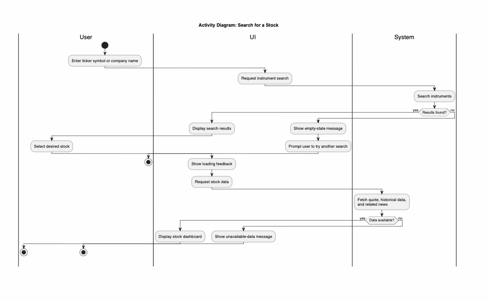

# 1 Use-Case Name
Search for a Stock

## 1.1 Brief Description
Users can search for a stock by its ticker symbol or company name to explore its financial data. The system allows users to view the current market price, historical price charts, and related financial news. The interface is designed to provide loading feedback and gracefully handle missing data or empty search results.

# 2 Flow of Events
## 2.1 Basic Flow
- User enters a ticker symbol or company name into the search bar.
- UI requests an instrument Search.
- System searches instruments and returns matches.
- UI displays the search results.
- User selects the desired instrument from the list.
- UI displays visible loading feedback.
- System fetches the current quote, historical price data, and related news.
- UI displays the stock dashboard with the retrieved data.
- System optionally establishes a WebSocket connection for live market updates (when implemented).

### 2.1.1 Activity Diagram



### 2.1.2 Mock-up

**S1: Search screen**


**S2: Search results**


**S3: No stock found (alternative flow)**

.png>)

**S4: Stock detail**

.png>)

**S5: Loading feedback**


**S6: Data unavailable (alternative flow)**

.png>)

### 2.1.3 Narrative
```gherkin
Feature: search for a stock

  As a user
  i want to search for a financial instrument by ticker or company name
  in order to view its market data, charts, and news.

  Background:
    And I am on the homepage

  Scenario: successful stock search
    Given I am on the "main" page
    When I enter "AAPL" in the search field
    And I press the "search" button
    Then I see "AAPL - Apple Inc." in the search results
    When I click on "AAPL - Apple Inc."
    Then I see a loading indicator
    And I am routed to the "stock dashboard" page for "AAPL"
    And I see the current price, historical chart, and recent news

  Scenario: no results found
    Given I am on the "main" page
    When I enter "INVALIDTICKER123" in the search field
    And I press the "search" button
    Then I receive an "empty state" message

  Scenario: data unavailable
    Given I am on the "main" page
    When I enter "AAPL" in the search field
    And I press the "search" button
    And I click on "AAPL - Apple Inc."
    And the external provider is down
   Then I receive an "unavailable-data" message on the dashboard
   ```

## 2.2 Alternative Flows
### 2.2.1 No Results Found
- System cannot find any instruments matching the search query.
- UI displays a clear empty-state message indicating no results were found.
- User is prompted to try a different search term.

### 2.2.2 Data Unavailable
- System fails to fetch the quote, history, or news from external providers after the user selects a stock.
- UI displays a clear unavailable-data message on the dashboard.
- The dashboard gracefully handles the missing data without exposing stack traces or crashing.

# 3 Special Requirements
## 3.1 Performance
The system must return a successful stock search response within 2 seconds for at least 95% of requests when data is cached or available locally. The initial analysis page shall provide visible loading feedback within 1 second.

## 3.2 Compliance and Language
Any insights or labels provided on the resulting dashboard must use neutral language (e.g., "insight", "scenario") and strictly avoid wording that instructs a user to buy or sell.   

# 4 Preconditions
## 4.1 Platform Access
The user has to have the platform application open in a supported web browser.

# 5 Postconditions
## 5.1 Dashboard Rendered
The system successfully displays the stock's market data, charts, and news.

# 6 Extension Points
## 6.1 Generate Research Brief
Once the dashboard is loaded, the user can trigger the AI research assistant to generate a structured, evidence-based brief for the selected stock
