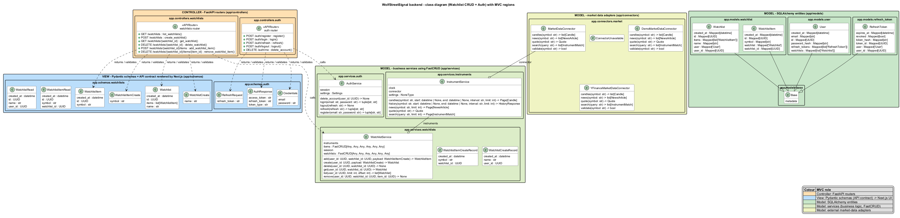

### 5.2 Class diagram

*Figure 5.2: class diagram of the FastAPI backend for the Watchlist CRUD and
Authentication use cases. It was generated from the source code with
pyreverse (pylint 4.1.4) and rendered with PlantUML; nothing was drawn by
hand. Source: [`class-diagram-mvc.puml`](class-diagram-mvc.puml).
Regeneration steps: [`README.md`](README.md).*

**MVC regions (colours in the diagram):**

- **Controller (orange)**: `watchlists router` and `auth router` in
  `app/controllers`. They map HTTP endpoints to handlers, for example
  `POST /watchlists/{watchlist_id}/items → add_watchlist_item()`, and delegate
  to the services.
- **View (blue)**: the Pydantic schemas in `app/schemas` (`WatchlistCreate`,
  `Watchlist`, `WatchlistItem`, `Credentials`, `AuthResponse`, ...). They form
  the validated JSON contract that the Next.js frontend renders.
- **Model (greens)**:
  - the SQLAlchemy entities in `app/models` (`User`, `Watchlist`,
    `WatchlistItem` and `RefreshToken`, all inheriting from `Base`);
  - the services in `app/services`: `WatchlistService` (built on FastCRUD),
    `AuthService` and `InstrumentService`;
  - the market-data adapters in `app/connectors` (`MarketDataConnector` with
    `YFinanceMarketDataConnector` and `DemoMarketDataConnector`).

**How to read it:** dashed arrows go from a router to the schemas and services
it uses. `WatchlistService` aggregates `InstrumentService`, which aggregates a
`MarketDataConnector`; this is how a ticker is checked before it is added to a
watchlist. The links between entities are shown as typed attributes (for
example `User.watchlists : Mapped[list['Watchlist']]`). The table relations
themselves are in the EER model in section 9.

A module-level view of the same code, also generated by pyreverse, is in
[`package-diagram-mvc.png`](../Media/package-diagram-mvc.png).
